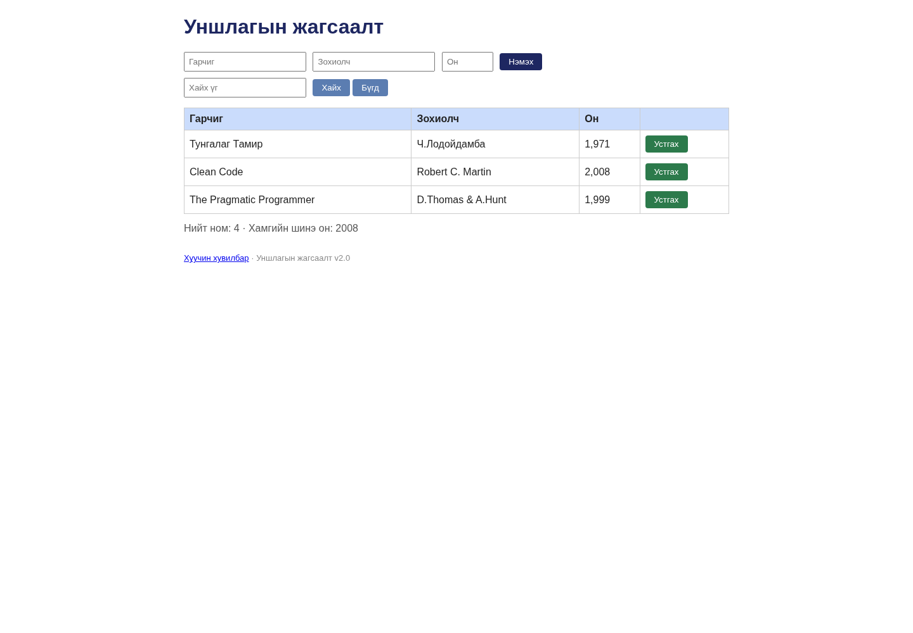

# BUG-01: Анхны 3 номын тоолуур 4 гэж харагдана

Орчин: Уншлагын жагсаалт v2.0; Node.js v20.19.2; Chromium 154.0.8037.57 (headless); Debian GNU/Linux 13.6 x86_64; 2026-10-20; Asia/Ulaanbaatar. UI viewport 1440 × 1000, өөрөөр заагаагүй бол.

Урьдчилсан нөхцөл: Багшийн өөрчлөгдөөгүй app.js файлыг репозиторийн үндсэн хавтаст байрлуулсан. Өөрийн өмнөх app процессыг зогсоож, `node app.js`-ийг шинээр асаасан; анхны «Тунгалаг Тамир», «Clean Code», «The Pragmatic Programmer» гэсэн 3 номтой. UI-д `http://localhost:3000`-г нээнэ. Хэрэв Node-ийн олон хувилбартай бол `node -v` нь v20.19.2 гэдгийг эхлээд батална.

## Дахин гаргах алхам

1. Урьдчилсан нөхцөлийн дагуу аппыг шинээр асааж үндсэн хуудсыг нээнэ.
2. Хүснэгтийн номын мөрүүдийг тоолно.
3. Доорх «Нийт ном» тоолуурыг уншина.

Хүлээгдэж байсан: «Нийт ном» нь хүснэгтэд буй номын тоотой тэнцүү: 3 мөртэй үед 3 байна.

Бодит үр дүн: Хүснэгт 3 номтой байхад «Нийт ном: 4 · Хамгийн шинэ он: 2008» гэж харагдана. 30 baseline reload болон эцсийн 25 UI replay тойрогт давтагдсан. `/api/books`-ийн baseline массив 3 объекттой, `/api/stats` нь `{"total":4,"newest":2008}` буцаасан.

Ноцтой байдал: **Minor — тоон мэдээлэл үргэлж зөрүүтэй боловч үндсэн нэмэх/устгах үйлдлийг бүрэн хаахгүй.**

## Хавсралт

- [baseline-books-curl.txt](../evidence/baseline-books-curl.txt)
- [bug-01-curl.txt](../evidence/bug-01-curl.txt)

- [Орчны мэдээлэл](../evidence/environment.json)
- [Session report](../session-report.md)

Олдсон аялал: **Supermodel**.
