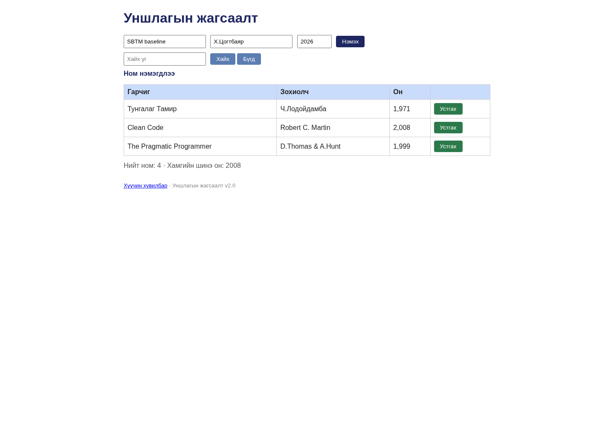

# BUG-04: Ном устгасны дараа «Ном нэмэгдлээ» мессеж хэвээр үлдэнэ

Орчин: Уншлагын жагсаалт v2.0; Node.js v20.19.2; Chromium 154.0.8037.57 (headless); Debian GNU/Linux 13.6 x86_64; 2026-10-20; Asia/Ulaanbaatar. UI viewport 1440 × 1000, өөрөөр заагаагүй бол.

Урьдчилсан нөхцөл: Багшийн өөрчлөгдөөгүй app.js файлыг репозиторийн үндсэн хавтаст байрлуулсан. Өөрийн өмнөх app процессыг зогсоож, `node app.js`-ийг шинээр асаасан; анхны «Тунгалаг Тамир», «Clean Code», «The Pragmatic Programmer» гэсэн 3 номтой. UI-д `http://localhost:3000`-г нээнэ. Хэрэв Node-ийн олон хувилбартай бол `node -v` нь v20.19.2 гэдгийг эхлээд батална.

## Дахин гаргах алхам

1. Шинэ апп дээр Гарчиг=`SBTM baseline`, Зохиолч=`Х.Цогтбаяр`, Он=`2026` бөглөнө.
2. «Нэмэx» товчийг дарж шинэ дөрөв дэх мөр нэмэгдтэл хүлээнэ.
3. Зөвхөн шинээр нэмсэн «SBTM baseline» мөрийн «Устгах» товчийг дарна.
4. Хүснэгт 3 мөр болсны дараа үйлдлийн мессежийг уншина.

Хүлээгдэж байсан: «Үйлдэл бүрийн дараах мессеж тухайн үйлдэлдээ тохирно»: устгасны дараа устгасан үйлдлийг илэрхийлсэн мэдээлэл харагдана.

Бодит үр дүн: Шинэ номын мөр үнэхээр устаж, хүснэгт 3 мөр болсон боловч мессеж «Ном нэмэгдлээ» хэвээр үлддэг. Screenshot нь устгасны дараах төлөв. Эцсийн 25 replay тойрогт яг эдгээр алхмаар баталсан.

Ноцтой байдал: **Minor — үйлдэл гүйцэтгэсэн ч хэрэглэгчид эсрэг үйлдлийн мэдээлэл харуулна.**

## Хавсралт

- [Орчны мэдээлэл](../evidence/environment.json)
- [Session report](../session-report.md)

Олдсон аялал: **Supermodel**.
