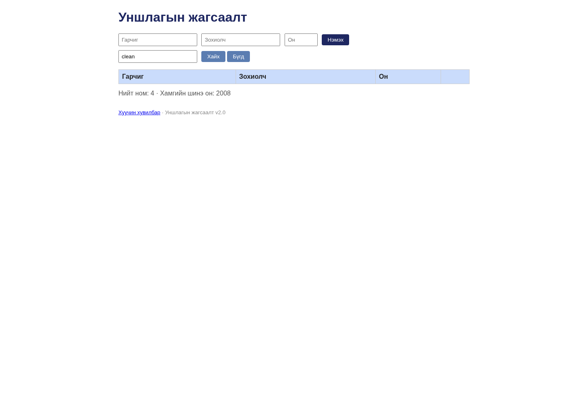

# BUG-06: Хайлт том/жижиг үсэг ялгаж байгаа тул clean хайлт Clean Code-ийг олохгүй

Орчин: Уншлагын жагсаалт v2.0; Node.js v20.19.2; Chromium 154.0.8037.57 (headless); Debian GNU/Linux 13.6 x86_64; 2026-10-20; Asia/Ulaanbaatar. UI viewport 1440 × 1000, өөрөөр заагаагүй бол.

Урьдчилсан нөхцөл: Багшийн өөрчлөгдөөгүй app.js файлыг репозиторийн үндсэн хавтаст байрлуулсан. Өөрийн өмнөх app процессыг зогсоож, `node app.js`-ийг шинээр асаасан; анхны «Тунгалаг Тамир», «Clean Code», «The Pragmatic Programmer» гэсэн 3 номтой. UI-д `http://localhost:3000`-г нээнэ. Хэрэв Node-ийн олон хувилбартай бол `node -v` нь v20.19.2 гэдгийг эхлээд батална.

## Дахин гаргах алхам

1. Шинэ аппын «Хайх үг» талбарт `clean` гэж жижиг үсгээр оруулна.
2. «Хайх» товчийг дарж хүснэгт шинэчлэгдэхийг хүлээнэ.
3. Ижил талбарт `Clean` гэж оруулаад «Хайх» дарж эерэг хяналттай харьцуулна.

Хүлээгдэж байсан: «Хайлт гарчиг болон зохиолчоос хайх ба том/жижиг үсэг ЯЛГАХГҮЙ»: хоёр хайлт хоёулаа «Clean Code» номыг олно.

Бодит үр дүн: `clean` нь 0 мөр, `Clean` нь «Clean Code / Robert C. Martin / 2,008» гэсэн 1 мөр буцаана. `robert`/`Robert`, `тунгалаг`/`Тунгалаг` хосууд мөн 0/1 мөртэй. Эдгээрийг нэг case-insensitivity согогт нэгтгэсэн.

Ноцтой байдал: **Major — үндсэн хайлт хүчинтэй номыг үсгийн хэмжээнээс шалтгаалан олохгүй.**

## Хавсралт

- [search-special-characters.json](../evidence/search-special-characters.json)

- [Орчны мэдээлэл](../evidence/environment.json)
- [Session report](../session-report.md)

Олдсон аялал: **Supermodel**.
