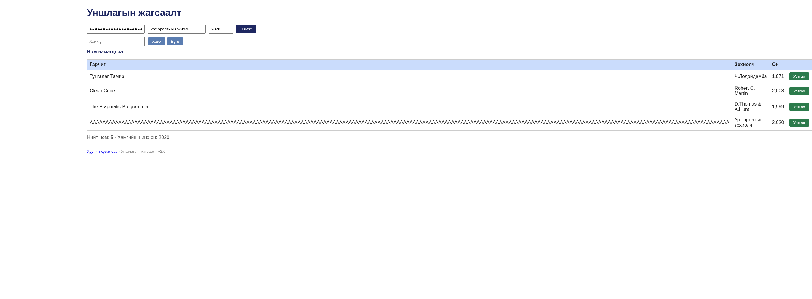

# BUG-07: 200 тэмдэгттэй гарчиг хүснэгтийг viewport-оос хэт сунгана

Орчин: Уншлагын жагсаалт v2.0; Node.js v20.19.2; Chromium 154.0.8037.57 (headless); Debian GNU/Linux 13.6 x86_64; 2026-10-20; Asia/Ulaanbaatar. UI viewport 1440 × 1000, өөрөөр заагаагүй бол.

Урьдчилсан нөхцөл: Багшийн өөрчлөгдөөгүй app.js файлыг репозиторийн үндсэн хавтаст байрлуулсан. Өөрийн өмнөх app процессыг зогсоож, `node app.js`-ийг шинээр асаасан; анхны «Тунгалаг Тамир», «Clean Code», «The Pragmatic Programmer» гэсэн 3 номтой. UI-д `http://localhost:3000`-г нээнэ. Хэрэв Node-ийн олон хувилбартай бол `node -v` нь v20.19.2 гэдгийг эхлээд батална.

## Дахин гаргах алхам

1. Шинэ аппыг 1440 × 1000 viewport-д нээнэ.
2. Гарчигт доорх код блок дахь 200 ширхэг A-г зайгүй хуулж оруулна.
3. Зохиолч=`Урт оролтын зохиолч`, Он=`2020` бөглөнө.
4. «Нэмэx» товчийг дарж хүснэгт шинэчлэгдэхийг хүлээнэ.
5. Хуудасны хэвтээ scroll болон хүснэгтийн баруун талын багануудыг ажиглана.

200 тэмдэгттэй гарчиг (нэг мөр, зайгүй):

```text
AAAAAAAAAAAAAAAAAAAAAAAAAAAAAAAAAAAAAAAAAAAAAAAAAAAAAAAAAAAAAAAAAAAAAAAAAAAAAAAAAAAAAAAAAAAAAAAAAAAAAAAAAAAAAAAAAAAAAAAAAAAAAAAAAAAAAAAAAAAAAAAAAAAAAAAAAAAAAAAAAAAAAAAAAAAAAAAAAAAAAAAAAAAAAAAAAAAAAAAA
```

Хүлээгдэж байсан: «Хүснэгт ямар ч урттай оролтод эвдрэхгүй»: урт текст зохистой wrap/хязгаарлалттай дүрслэгдэж, хүснэгт хуудасны өргөнийг эвдэхгүй.

Бодит үр дүн: 1440 px viewport дээр document.scrollWidth 2709 px, table өргөн 2418.5 px болж, хэвтээ scroll үүсэж баруун талын баганууд дэлгэцээс гарна. Baseline table 860 px. 320–1920 px өөр өргөнүүд дээр давтагдсан. Full-page screenshot нь бүх 2709 px өргөнийг багтаасан тул GitHub дээр жижигрэн харагдаж болно.

Ноцтой байдал: **Minor — урт оролт нь харагдах байдал, баруун талын удирдлагын хүртээмжийг эвдэнэ; хэвтээ scroll-оор хүрэх боломжтой.**

## Хавсралт



- [viewport-long-title.json](../evidence/viewport-long-title.json)

- [Орчны мэдээлэл](../evidence/environment.json)
- [Session report](../session-report.md)

Олдсон аялал: **Supermodel**.
