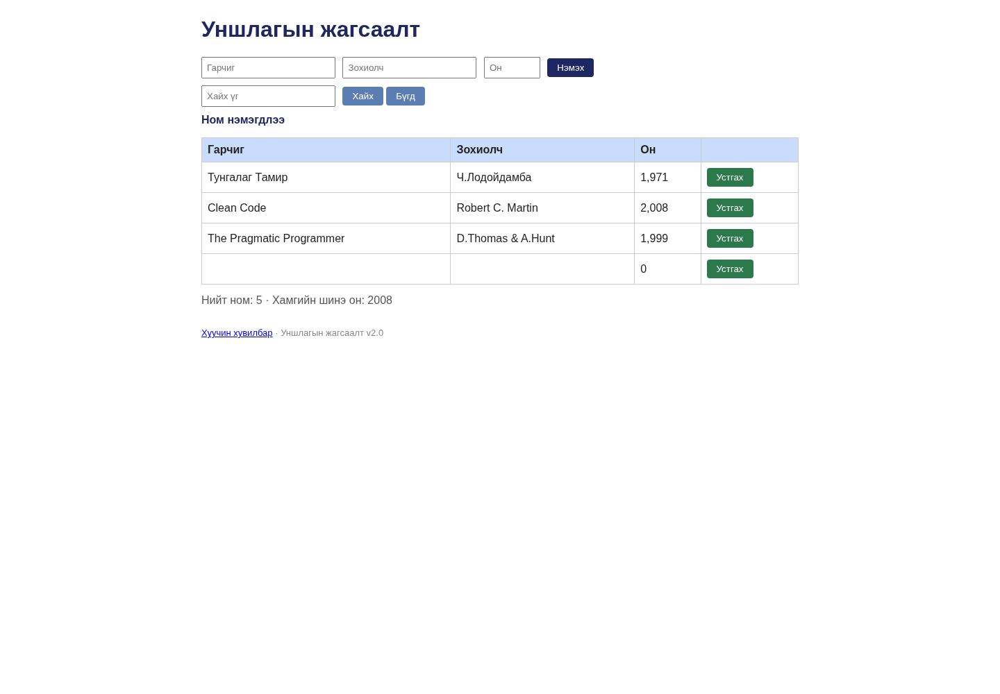

# BUG-09: Заавал бөглөх талбарууд хоосон байхад ном нэмэгдэнэ

Орчин: Уншлагын жагсаалт v2.0; Node.js v20.19.2; Chromium 154.0.8037.57 (headless); Debian GNU/Linux 13.6 x86_64; 2026-10-20; Asia/Ulaanbaatar. UI viewport 1440 × 1000, өөрөөр заагаагүй бол.

Урьдчилсан нөхцөл: Багшийн өөрчлөгдөөгүй app.js файлыг репозиторийн үндсэн хавтаст байрлуулсан. Өөрийн өмнөх app процессыг зогсоож, `node app.js`-ийг шинээр асаасан; анхны «Тунгалаг Тамир», «Clean Code», «The Pragmatic Programmer» гэсэн 3 номтой. UI-д `http://localhost:3000`-г нээнэ. Хэрэв Node-ийн олон хувилбартай бол `node -v` нь v20.19.2 гэдгийг эхлээд батална.

## Дахин гаргах алхам

1. Шинэ аппын Гарчиг, Зохиолч, Он гурвыг бүгдийг хоосон орхино.
2. «Нэмэx» товчийг дарна.
3. Хүснэгт болон үйлдлийн мессежийг ажиглана.
4. Хуудсыг дахин нээж хоосон ном хадгалагдсан эсэхийг шалгана.

Хүлээгдэж байсан: «Гарчиг, Зохиолч, Он ... бүгд заавал бөглөгдсөн ... дутуу бол ном нэмэгдэхгүй, ойлгомжтой алдааны мессеж харагдана»: 3 ном хэвээр байна.

Бодит үр дүн: Дөрөв дэх ном нэмэгдэж, гарчиг/зохиолч нь хоосон, он 0, мессеж «Ном нэмэгдлээ» болно. Reload дараа ч 4 мөртэй. Нэг нэг талбар дутуу, зөвхөн нэг талбар бөглөсөн, зай/tab оролтын хувилбарууд мөн нэмэгдсэн; бүгдийг энэ нэг required-field согогт нэгтгэсэн. API `{}` control HTTP 201 өгсөн нотолгоо өмнөх session-д хадгалагдсан.

Ноцтой байдал: **Major — заавал байх өгөгдөлгүй ном бүртгэж жагсаалтын бүрэн бүтэн байдлыг алдагдуулна.**

## Хавсралт

- [bug-09-first-observation.json](../evidence/bug-09-first-observation.json)
- [bug-09-curl.txt](../evidence/bug-09-curl.txt)
- [bug-09-request.json](../evidence/bug-09-request.json)

- [Орчны мэдээлэл](../evidence/environment.json)
- [Session report](../session-report.md)

Олдсон аялал: **Couch Potato**.
