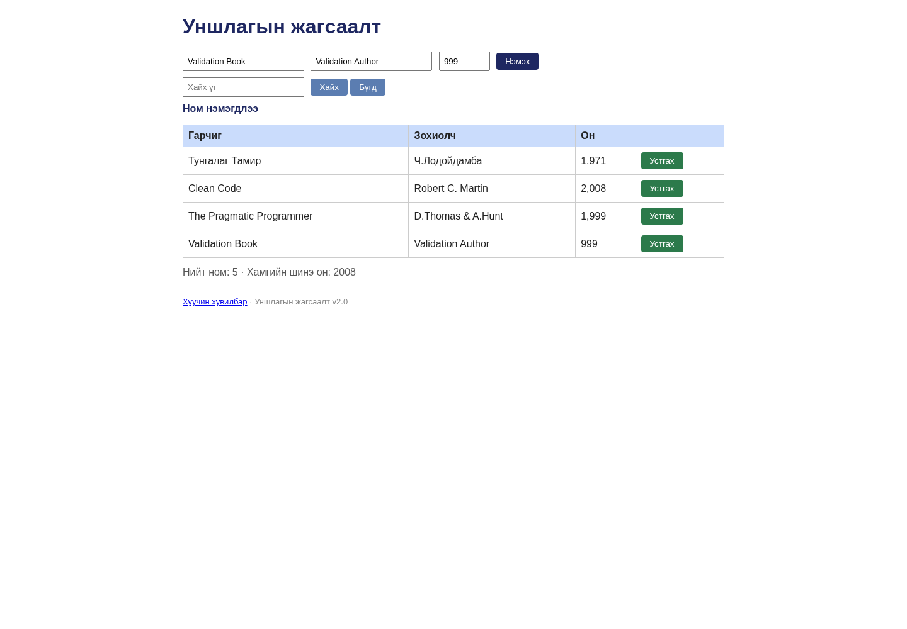

# BUG-10: Он 1000–2100 бүхэл тоо байх шалгалт хийгдэхгүй

Орчин: Уншлагын жагсаалт v2.0; Node.js v20.19.2; Chromium 154.0.8037.57 (headless); Debian GNU/Linux 13.6 x86_64; 2026-10-20; Asia/Ulaanbaatar. UI viewport 1440 × 1000, өөрөөр заагаагүй бол.

Урьдчилсан нөхцөл: Багшийн өөрчлөгдөөгүй app.js файлыг репозиторийн үндсэн хавтаст байрлуулсан. Өөрийн өмнөх app процессыг зогсоож, `node app.js`-ийг шинээр асаасан; анхны «Тунгалаг Тамир», «Clean Code», «The Pragmatic Programmer» гэсэн 3 номтой. UI-д `http://localhost:3000`-г нээнэ. Хэрэв Node-ийн олон хувилбартай бол `node -v` нь v20.19.2 гэдгийг эхлээд батална.

## Дахин гаргах алхам

1. Шинэ апп дээр Гарчиг=`Validation Book`, Зохиолч=`Validation Author`, Он=`999` бөглөнө.
2. «Нэмэx» товчийг дарна.
3. Нэмэгдсэн мөрийн он болон мессежийг ажиглана.
4. Хуудсыг дахин нээж 999 онтой ном хадгалагдсан эсэхийг шалгана.

Хүлээгдэж байсан: «Он нь 1000–2100 хоорондох бүхэл тоо»: 999-ийг буцааж, ном нэмэхгүй бөгөөд ойлгомжтой validation алдаа харуулна.

Бодит үр дүн: 999 онтой дөрөв дэх ном нэмэгдэж, «Ном нэмэгдлээ» харуулж, reload-д хадгалагдана. Шинэ апп бүрээс шалгасан 2101, -1, 2020.5 мөн зөвшөөрөгдсөн; abc/2020abc нь NaN, Infinity нь ∞ гэж дүрслэгдсэн. Хил доторх 1000 ба 2100 эерэг control ажилласан. Эдгээрийг нэг numeric year-validation согогт нэгтгэсэн.

Ноцтой байдал: **Major — хязгаараас гадуурх, бутархай болон тоон бус оны өгөгдөл хадгалагдана.**

## Хавсралт

- [bug-10-first-observation.json](../evidence/bug-10-first-observation.json)
- [bug-10-curl.txt](../evidence/bug-10-curl.txt)
- [bug-10-request.json](../evidence/bug-10-request.json)

- [Орчны мэдээлэл](../evidence/environment.json)
- [Session report](../session-report.md)

Олдсон аялал: **Couch Potato**.
