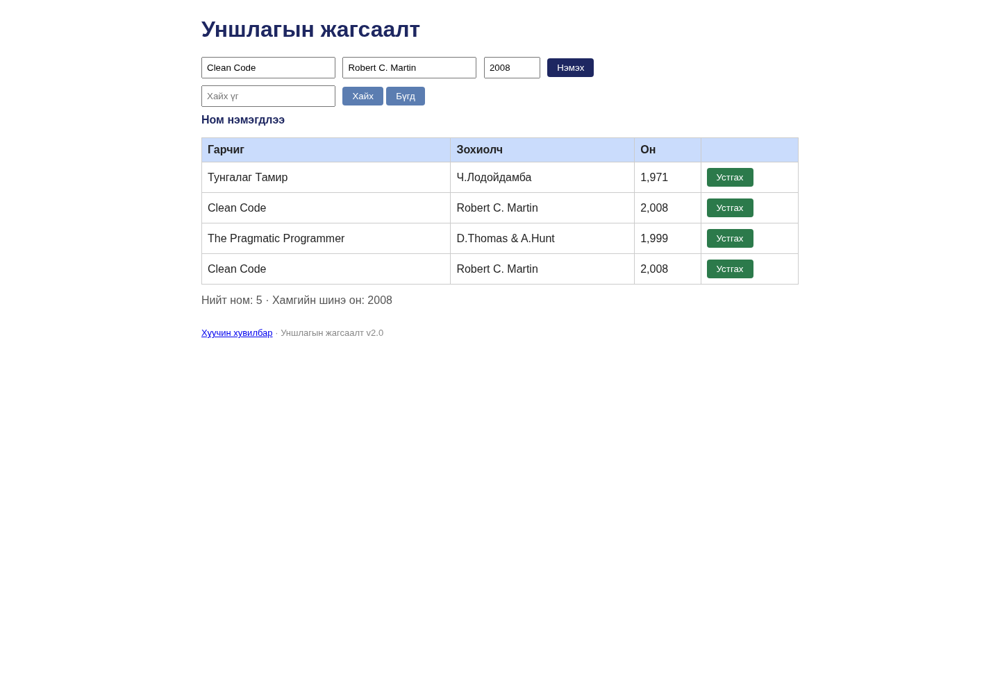

# BUG-11: Ижил гарчиг, зохиолчтой Clean Code ном давхар бүртгэгдэнэ

Орчин: Уншлагын жагсаалт v2.0; Node.js v20.19.2; Chromium 154.0.8037.57 (headless); Debian GNU/Linux 13.6 x86_64; 2026-10-20; Asia/Ulaanbaatar. UI viewport 1440 × 1000, өөрөөр заагаагүй бол.

Урьдчилсан нөхцөл: Багшийн өөрчлөгдөөгүй app.js файлыг репозиторийн үндсэн хавтаст байрлуулсан. Өөрийн өмнөх app процессыг зогсоож, `node app.js`-ийг шинээр асаасан; анхны «Тунгалаг Тамир», «Clean Code», «The Pragmatic Programmer» гэсэн 3 номтой. UI-д `http://localhost:3000`-г нээнэ. Хэрэв Node-ийн олон хувилбартай бол `node -v` нь v20.19.2 гэдгийг эхлээд батална.

## Дахин гаргах алхам

1. Шинэ аппын анхны «Clean Code / Robert C. Martin / 2,008» мөр байгааг батална.
2. Гарчиг=`Clean Code`, Зохиолч=`Robert C. Martin`, Он=`2008` бөглөнө.
3. «Нэмэx» товчийг дарна.
4. Ижил гарчиг, зохиолчтой мөрүүдийг тоолж, хуудсыг дахин нээнэ.

Хүлээгдэж байсан: «Ижил гарчиг, зохиолчтой ном давхардуулж нэмэгдэхгүй»: нэг Clean Code номтой, нийт 3 мөр хэвээр байна.

Бодит үр дүн: Яг ижил гарчиг, зохиолч, онтой хоёр мөр үүсэж нийт 4 ном болно; reload-д хадгалагдана. Оныг 1999 болгосон хувилбар болон «Тунгалаг Тамир / Ч.Лодойдамба / 1971» давхардал мөн нэмэгдсэн. Өөр зохиолчтой ижил гарчгийн control нэмэгдсэн нь зөв; case/зайны normalization нь спецификацид нарийн заагаагүй тул тусдаа согог тооцоогүй.

Ноцтой байдал: **Major — duplicate хориг ажиллахгүйгээс номын өгөгдөл давхардаж бүртгэгдэнэ.**

## Хавсралт

- [bug-11-first-observation.json](../evidence/bug-11-first-observation.json)
- [bug-11-curl.txt](../evidence/bug-11-curl.txt)
- [bug-11-request.json](../evidence/bug-11-request.json)

- [Орчны мэдээлэл](../evidence/environment.json)
- [Session report](../session-report.md)

Олдсон аялал: **Couch Potato**.
